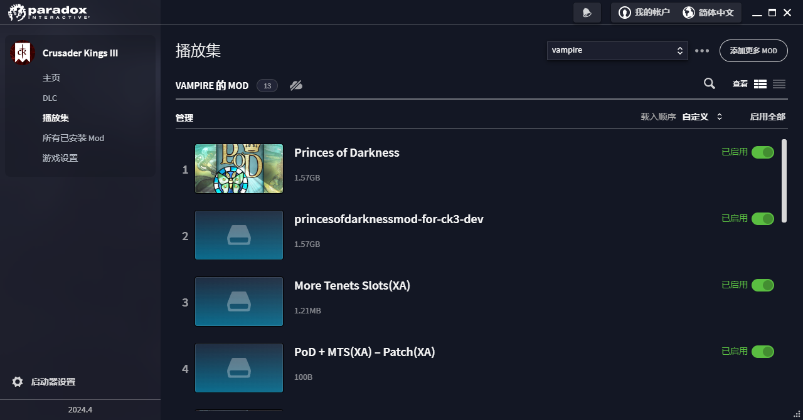

# More Tenets Slots(XA)

`more_tenets_slots_xa_dev/` extends the native core tenet limit to **100**, with scrollable rite creation and faith views. Version 11 inherits vanilla culture tradition limits; extra tradition slots are no longer bundled.

The latest published release is [v11, published on 2026-10-16](docs/workshop/publication-v11.md) for CK3 **1.20.0.4**. Upload, complete anonymous description and Change Notes readback, and a fresh 48-file Workshop cache match passed. Final loading of that cache is pending: [R24](docs/native-cache-r24-2026-10-16.md) stopped before game launch because the shared runtime rejected its profile schema. The overall release closure remains incomplete. See the [v11 changelog](docs/release-changelogs/more-tenets-slots/11.md), [bug checklist](docs/bugfix-plan-2026-10-15.md), and [results](docs/bugfix-report-2026-10-15.md).

Historical validation: [migration report](docs/migration-report.md), [localization format coverage](docs/localization-coverage.md), [sparse tenet creation](docs/live-R0012-sparse-create.md), and [cold reload](docs/live-R0013-cold-reload.md). These results apply to their recorded game build and product bytes. New live validation uses Simplified Chinese only; other supported languages receive format checks. POD products require their own migration and acceptance.

Based on Holger's mod, with thanks to its original author. [Source repository](https://github.com/XenoAmess/ck3_mod_more_tenant_slots), [original mod](https://steamcommunity.com/sharedfiles/filedetails/?id=2904268802), [Workshop product](https://steamcommunity.com/sharedfiles/filedetails/?id=3182367229).

###  **pod_mts_xa_patch_xa_dev** folder:

It is the MTS patch for Princes of Darkness mod.

It is modified from modified original mod, and standalone(don't need any other MTS mod with it)

source codes: https://github.com/XenoAmess/ck3_mod_more_tenant_slots

original mod: https://steamcommunity.com/sharedfiles/filedetails/?id=2890708074

this mod: https://steamcommunity.com/sharedfiles/filedetails/?id=3182385109

POD mod: https://steamcommunity.com/sharedfiles/filedetails/?id=2216659254

### order

