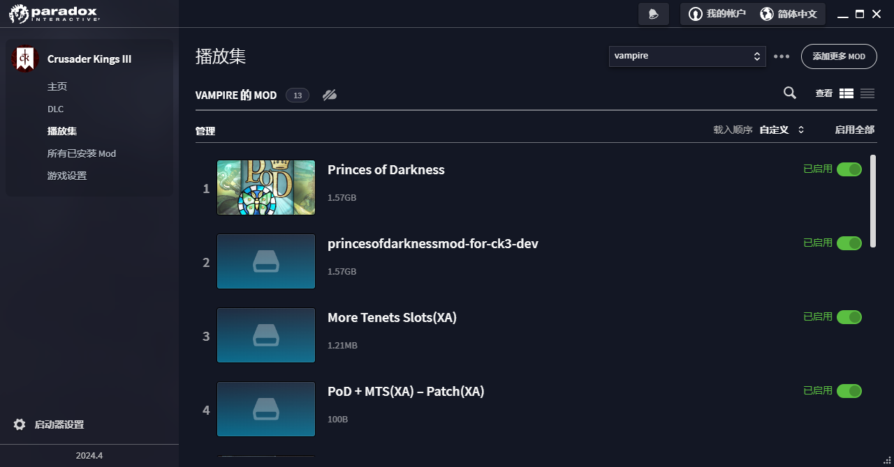

# More Tenets Slots(XA)

`more_tenets_slots_xa_dev/` extends the native core tenet limit to **100**, with scrollable rite creation and faith views. Version 12 inherits vanilla culture tradition limits; extra tradition slots are no longer bundled.

The latest published release is [v12, published on 2026-11-19](docs/workshop/publication-v12.md) for CK3 **1.21.0 (Florin)**. Simplified Chinese source and independent cold reload passed; complete public description/Change Notes/tags, fresh48-file cache match, actual cache loading, normal closure and final Steam offline/resource release passed. See the [v12 changelog](docs/release-changelogs/more-tenets-slots/12.md) and [live report](docs/live-report-2026-11-19.md). [v11/CK3 1.20.0.4](docs/workshop/publication-v11.md) remains historical evidence.

Historical validation: [migration report](docs/migration-report.md), [localization format coverage](docs/localization-coverage.md), [sparse tenet creation](docs/live-R0012-sparse-create.md), and [cold reload](docs/live-R0013-cold-reload.md). These results apply to their recorded game build and product bytes. New live validation uses Simplified Chinese only; other supported languages receive format checks. POD products require their own migration and acceptance.

Based on Holger's mod, with thanks to its original author. [Source repository](https://github.com/XenoAmess/ck3_mod_more_tenant_slots), [original mod](https://steamcommunity.com/sharedfiles/filedetails/?id=2904268802), [Workshop product](https://steamcommunity.com/sharedfiles/filedetails/?id=3182367229).

###  **pod_mts_xa_patch_xa_dev** folder:

It is the MTS patch for Princes of Darkness mod.

It is modified from modified original mod, and standalone(don't need any other MTS mod with it)

source codes: https://github.com/XenoAmess/ck3_mod_more_tenant_slots

original mod: https://steamcommunity.com/sharedfiles/filedetails/?id=2890708074

this mod: https://steamcommunity.com/sharedfiles/filedetails/?id=3182385109

POD mod: https://steamcommunity.com/sharedfiles/filedetails/?id=2216659254

### order

### Potential Output (XA)

[`mod_potential_output/`](mod_potential_output/) is a new independent CK3 1.21 submod for county potential trade goods, with a grouped goods filter panel. It reads native potential goods, including undeveloped resources, and keeps filter state local to the UI. Current implementation and verification status: [report](docs/potential-output-report.md); [acceptance plan](docs/potential-output-acceptance-plan.md). It has no Workshop ID and is independent of MTS and POD.

