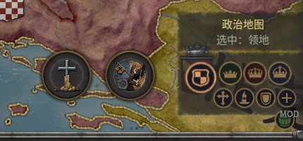
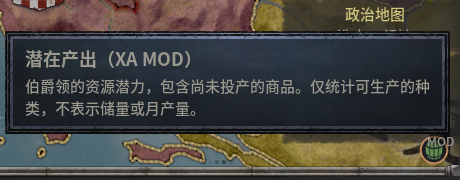
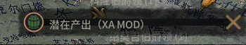
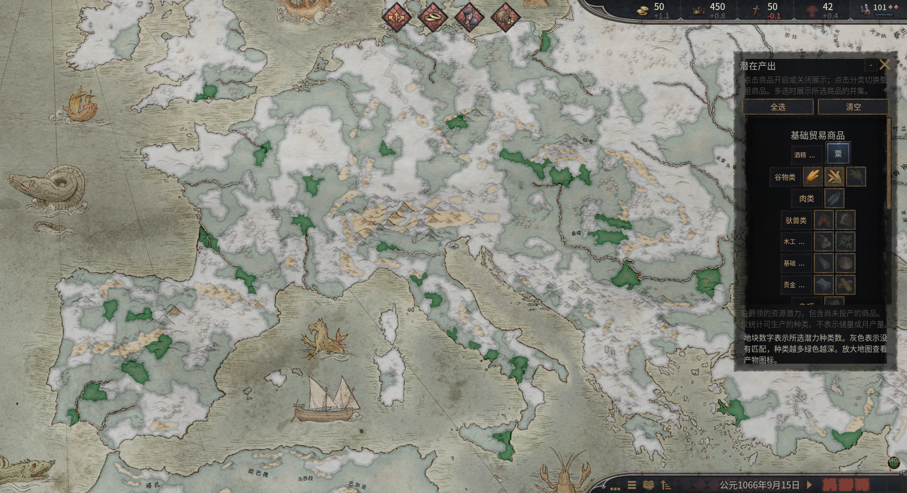
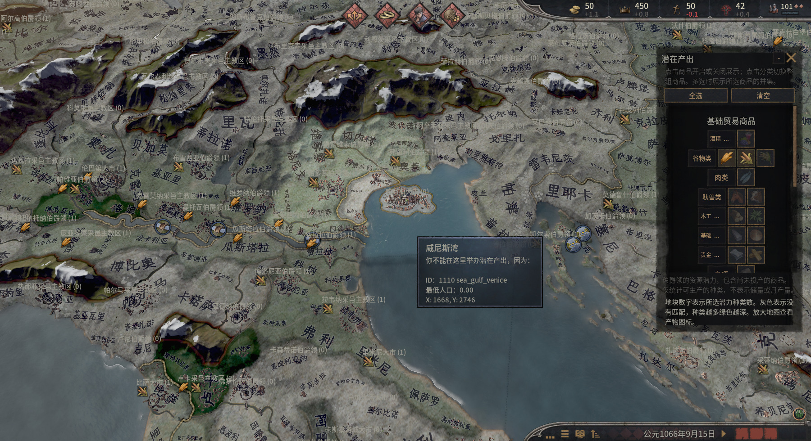

# 潜在产出 0.1.1：独立圆形入口验收

已实现并完成简体中文实机自测。入口采用独立注册的 32×32 原生风格圆形按钮，位于右下角原生“＋”下方，绿色资源图标配 MOD 角标。原生视角栏、原生“＋”和原生按钮位置均保留；不新增 mapmodes、hud、buttons 文件或原生视角同名类型的覆盖。

悬停显示“潜在产出（XA MOD）”及资源潜力说明。单击直接进入；全尺寸筛选面板的减号将其收成窄标题条，点击标题条左侧圆形图标或右下角圆形入口可重新展开，保留当前筛选。标题条和完整面板均可用叉号退出并恢复此前的地图模式。重新进入默认全选。

展示口径保持不变：读取原版伯爵领可以生产的商品，包含未开发资源；35 种潜力商品参与过滤，9 种仅加工商品不参与。选中谷物与粟时，灰色表示没有匹配，浅绿表示匹配一种，深绿表示匹配两种；近景显示县名、匹配数和商品图标。数字不是储量或月产量。

## 验收与交付范围

最终源码：`511e65a1028ff7415b78908f47876c072a9cc3d3`。实际游戏 CK3 **1.21.0.3 Florin / Steam build 26785313**，EXE SHA-256 `859f0d380098adcb130eb9d453458222749fcdf6d46126ad0ed99d78f9a0aa28`。实机编号 `pc-20260924rtuf-f11af23c08--potential-output--R0019`，独立 userdir，加载既有 1066 年威尼斯存档，客户端 1800×980。

| 验证 | 结果 |
| --- | --- |
| 静态结构、可逆投影、九语言编码及键集、生成一致性与行为回归 | 11 项通过，12.417 秒 |
| 独立产品构建与 Workshop 身份回归 | 4 项通过，1.238 秒 |
| 原生栏及“＋”、独立入口、中文提示、连续三次单击进入 | 通过 |
| 单选、多选、分类开关、清空、全选、0/1/2 深浅色、近景图标 | 通过 |
| 窄标题条、展开保持筛选、退出恢复信仰模式、再次进入重置全选 | 通过 |
| 原生宴会说明、人工确认、普通宴会选址、取消规划 | 通过 |
| 公共验收入口的 22 项业务、原进程退出和资源闭合 | PASS |

潜在产出没有启动实际活动，观察前后日期保持 1066-09-15，金钱 50、威望 450。普通宴会进入选址后取消，未举办。原 Popen wait 返回 0，未请求 WM_CLOSE，keeper 无失败且线程结束，CAS 释放后资源列表为空。Steam 在运行前后均确认离线。

日志只保留一条已知的原版 `great_wall_china_gate.txt` Generated Map Objects 诊断（1005 字节），没有发现本产品 GUI、数据函数或脚本诊断。完整证据见 [R0019 验收记录](evidence/potential-output-entry-R0019.json)。原始桌面截图和私有存档留在忽略的本机 artifacts 中；上述公开图片仅裁去游戏以外区域，操作与原件哈希见 [图片来源](media/potential-output-entry-0.1.1/provenance.json)。

本地实测 ZIP：`artifacts/potential-output-entry-20261120/tested-build-a07/mod_potential_output.zip`，65392 字节，SHA-256 `0ab19f41a1c379562508205902bd7164fd12d38ee712d34045f705df7725359d`。23 份运行文件与实测冻结包一致。

这是仓库 0.1.1 的施工和自测交付，尚未更新 Steam 工坊；已发布的 0.1.0 及其描述、图片、缓存验收仍是独立历史版本。

## 兼容边界

独立入口不再增加原生视角栏文件或类型冲突，但本 Mod 原有的 `map_icon_layer.gui`、`window_activity_planner.gui`、`window_activity_list.gui` 三份 GUI 覆盖仍然存在。同样修改它们的 Mod 仍可能需要合并补丁；大幅调整 HUD 的 Mod 也可能与独立按钮发生视觉重叠。没有对第三方视角 Mod、MTS、POD、大地图转换或多人游戏做组合验收。其他八种语言仅做格式、编码和键集检查。没有验证所有分辨率、界面缩放或恢复此前相机位置/缩放；这里只确认地图模式恢复。

## 失败记录与归属

R0013、R0014 的字号最小值诊断、R0015 的 attachto 定位偏差均保留。R0016 暴露二次进入不能自动确认；R0017 的显示/隐藏标记仍不能重播已完成状态；R0018 的 Toggle 与字面字符串判断不一致，测试解释器也错误假设其值为 yes。最终改用显式 Set yes/no，交替两个进入状态，并修正解释器。R0019 独立重复验证全部关键路径，通过结论不合并借用失败场次。

产品源码、布局、实际存档、截图与具体证据归本仓库。通用解析、可逆投影、日志分析、构建和受管生命周期复用 ck3_eternal_recurrence。可复用的 GUI 字号约束、独立注册边界及重复状态触发经验作为框架文档富化；不搬运产品源码、第三方素材、机器配置或私有存档，也不外推其他产品通过。
