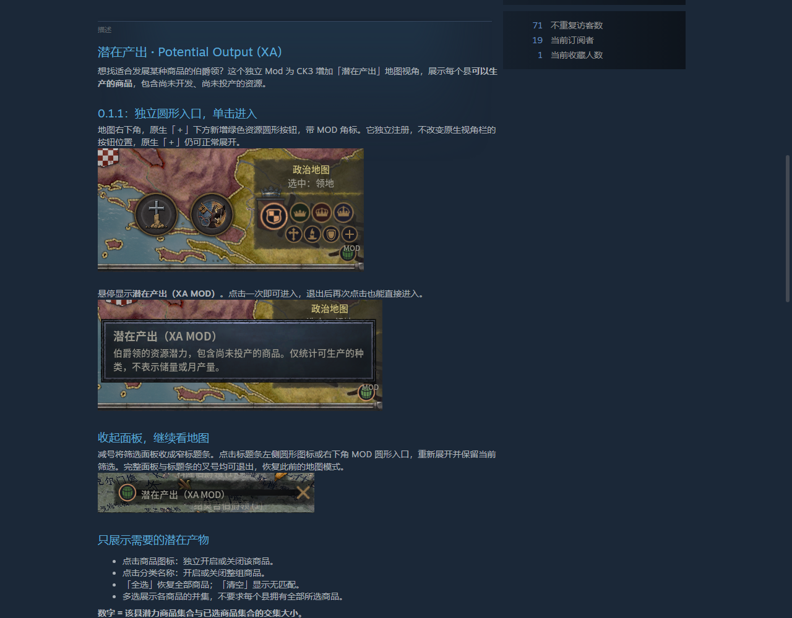
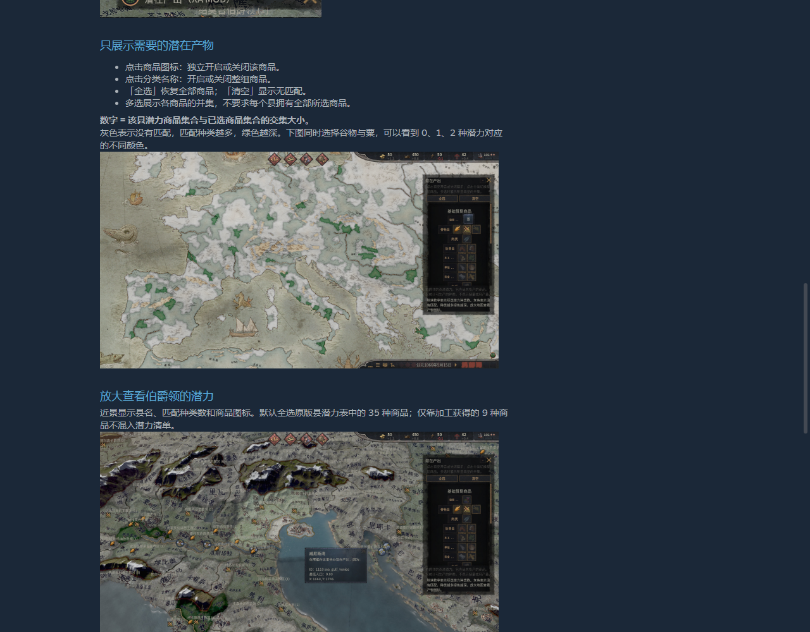

# 潜在产出 0.1.1：正式发布

2026-11-21（上海），新版已更新到既有 [Steam 创意工坊条目 3842767123](https://steamcommunity.com/sharedfiles/filedetails/?id=3842767123)，中文标题为“潜在产出 / Potential Output (XA)”。没有创建新条目或修改其他产品。

入口改为原生“＋”下方带 MOD 角标的独立绿色圆形按钮，单击直接进入，悬停“潜在产出（XA MOD）”。收起筛选面板会保留可展开、可退出的窄标题条。入口不覆盖原生视角栏；原有三份地图/活动 GUI 覆盖兼容边界保持。详细功能及失败修复见 [实机验收报告](../../potential-output-entry-0.1.1-report.md)。

[BBCode 说明](description.bbcode)、[更新日志](change-notes-0.1.1.txt)和[文本冻结清单](text-freeze-0.1.1.json)已上库。匿名回读确认中文标题、3049 字符说明和 10 行更新日志与仓库逐字一致，没有问号乱码。原生内容与媒体更新回调 EResult 为 1，未提出新的工坊协议确认。

图集已由四张旧图替换为五张新版实机截图；封面也已更新。正文在圆形入口、悬停、收起面板、深浅色筛选及县潜力图标的对应段落中穿插五张图，全部使用固定提交的公开直链。匿名浏览器实际加载全部五张，图片顺序与正文位置均已审阅；五张图集、封面和五张正文图片的下载字节共 11 项全部与仓库文件一致。





正式 tag `potential-output-v0.1.1-ck3-1.21.0.3` 指向 `c947381f4e09e57f9aeb62f3e0c89e97de133e1f`。两次构建 ZIP 均为 65392 字节，SHA-256 `0ab19f41a1c379562508205902bd7164fd12d38ee712d34045f705df7725359d`，23 份运行文件与源码 `511e65a` 的 R0019 实测包完全相同。正式 manifest 已绑定 canonical ID，descriptor 没有注入其他产品身份。

R0019 在 CK3 **1.21.0.3 Florin / build26785313** 上通过 22 项业务，包含连续三次单击进入、全部筛选、0/1/2 深浅色、原生“＋”、面板收起/展开、恢复信仰模式和普通宴会规划。11 项产品回归、4 项身份回归通过。其他八种语言仅验证格式、编码和键集。

发布后保全旧本机缓存，Steam SDK 在确认目标路径不存在后实际下载新内容，callback3406 的 app/item 匹配且 EResult1；23 文件的路径、大小和 SHA-256 全部精确匹配正式 manifest。R0020 使用公共 `workshop_cache` 用例，只验实际菜单加载和正常退出，没有重跑业务或开新战役。日志确认：

```text
Potential Output (XA)|mod/product.mod|Enabled
Mounted Data: C:/SteamLibrary/steamapps/workshop/content/1158310/3842767123
```

R0020 的原始 Popen 正常返回 0，未使用超时、STOP 或 WM_CLOSE；keeper 无失败，CAS 释放后屏幕资源为空。error.log 为 1005 字节，只观察到已知原版长城地图对象读取诊断，无产品错误；不宣称零日志。最终确认 Steam 离线，CK3 进程数为 0。

失败与恢复分别记录：第一次 GoOffline 仅返回 ACK，实读仍在线。随后在确认无游戏的情况下正常退出 Steam，只在客户端完全停止后更改当前账号的离线启动偏好，再静默重启并获得离线实读证明。原失败回执保留。首次匿名更新日志请求遇到 HTTP429，后续普通浏览器请求头的读取成功，公开文本逐字验证通过。

[结构化发布记录](publication-0.1.1.json)、[正式清单](evidence-0.1.1/release-manifest.json)、[公开文本核对](evidence-0.1.1/public-text-verification.json)、[缓存验收](evidence-0.1.1/verify-cache-a01.json)、[原 0.1.0 发布记录](publication-0.1.0.md)。公开图片只取游戏画面或匿名工坊页面；完整桌面、账号偏好原件、机器配置与私有存档不入库。

归属：产品文案、媒体和具体验收归本仓库；发布、图集、文本回读、缓存及受管生命周期复用框架。GUI 通用经验已以 `442508b53` 富化 [框架文档](https://github.com/XenoAmess/ck3_eternal_recurrence/blob/442508b53f14e5aa649b2f77d8bcd96557491480/docs/ck3-gui-independent-entry-notes.md)。不外推其他 Mod、分辨率或界面缩放组合通过。
